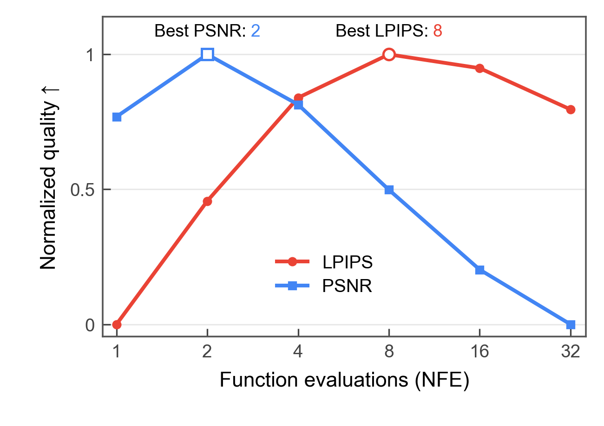
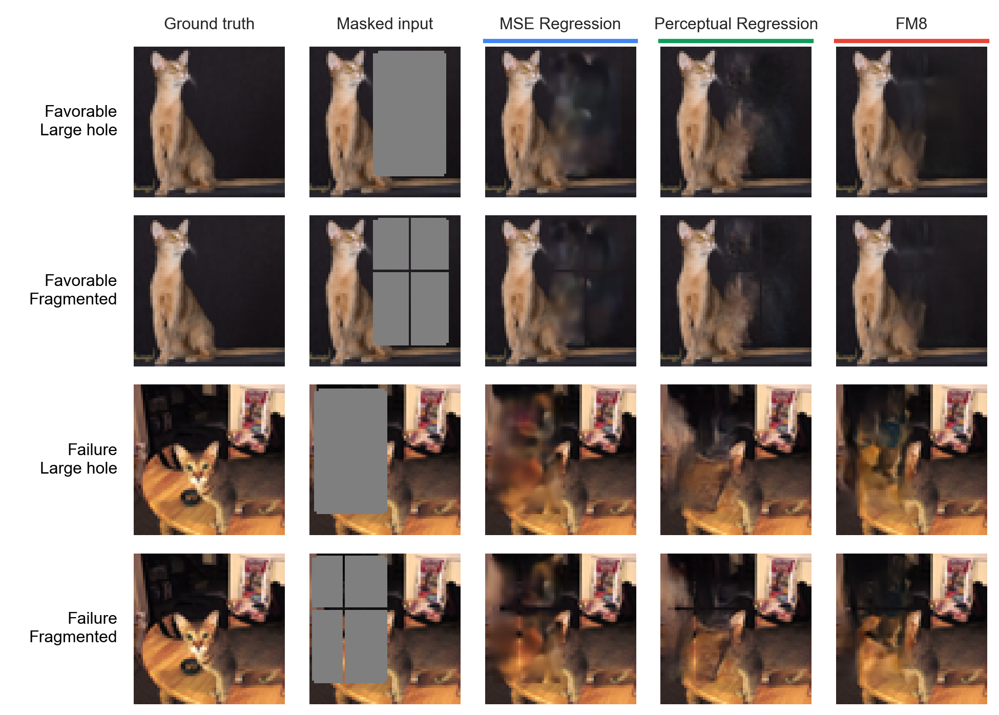
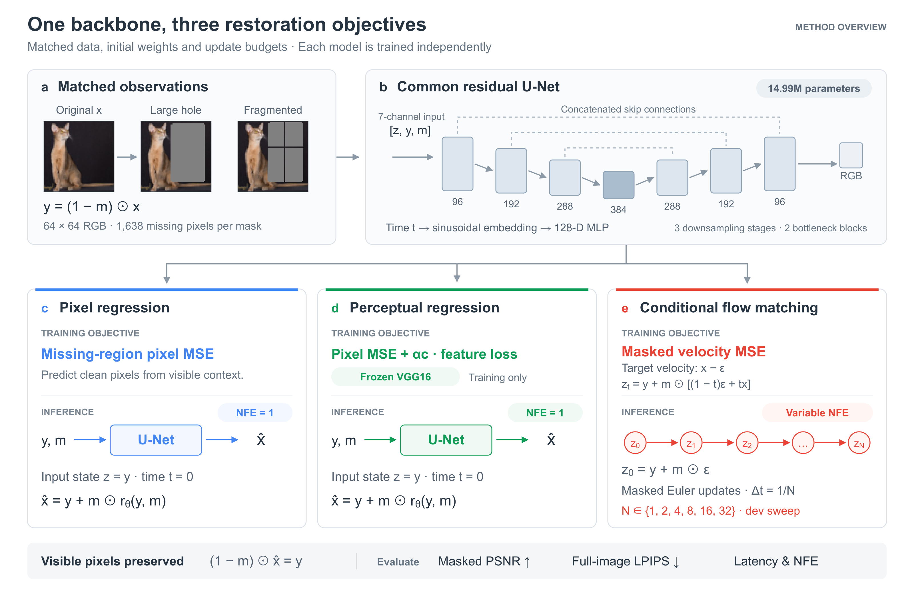

<h1 align="center">One Flow, Two Notions of Quality</h1>
<p align="center"><strong>Sampling Budgets for Image Inpainting</strong></p>
<p align="center">Yongji Chen · Kaichun You · Linwei Zhang · Zijun Tang</p>

<p align="center">
  <a href="paper/OneFlow_Report.pdf">Report</a> ·
  <a href="paper/OneFlow_Supplementary.pdf">Supplementary</a> ·
  <a href="docs/FIGURES.md">Figure gallery</a> ·
  <a href="docs/REPRODUCE.md">Reproduction</a> ·
  <a href="CITATION.cff">Citation</a>
</p>

**Does more sampling computation always improve image inpainting?** We compare conditional flow matching (FM) with pixel and perceptual regression, then vary the sampling budget within frozen FM models. All three restoration models share a CNN architecture, training data, and update budget.

<p align="center">
  
</p>

*Development scores averaged equally over two seeds and two mask geometries. Each metric is min–max normalized; LPIPS is reversed so higher means better. [Values and normalization](results/figure_values/fig01b_provenance.json).*

## Main finding

**The useful sampling budget depends on the quality criterion.** PSNR is highest at **2 evaluations**, while LPIPS is lowest at **8**. Larger tested budgets worsen both metrics. These budgets were compared on the development set; test evaluation uses the development-selected FM8 setting.

### Held-out test results

Means over two training seeds and 3,585 retained test images, with equal weighting of the two mask geometries:

| Method | NFE | LPIPS ↓ | Masked PSNR ↑ | Latency / image |
|---|---:|---:|---:|---:|
| Pixel regression | 1 | 0.13119 | 15.906 dB | 3.77 ms |
| Perceptual regression | 1 | 0.12046 | 15.723 dB | 3.82 ms |
| Conditional FM | 8 | **0.10621** | **16.159 dB** | 28.41 ms |

Against perceptual regression, FM8 reduces mean LPIPS by **11.8%** and improves mean PSNR by **0.437 dB**, at approximately **7.4×** the single-image inference latency. Timing uses batch size 1 on the recorded RTX 4090 system.

[Full test summary](results/test_summary.json) · [Timing records](results/latency.json) · [Evaluation protocol](docs/PROTOCOL.md)

### What the scores miss



*Selected favorable and failure examples from three archived test images. FM8 displays one fixed noise sample; selection scores average four samples. These examples illustrate behavior, not its frequency across the test set. Lower LPIPS does not ensure correct facial structure. [Selection and source provenance](results/qualitative/test_qualitative_provenance.json).*

## Method overview



The models share an architecture and matched training conditions. Pixel and perceptual regression use one forward pass; FM integrates a masked velocity field. Frozen VGG16 features supply training supervision for the perceptual control.

[Editable SVG](figures/main/fig02_framework.svg) · [HTML source](figures/main/fig02_framework.html) · [Diagram generator](scripts/build_framework.py)

*This repository diagram was redesigned after submission. The submitted report and supplementary PDFs remain unchanged.*

## Use the repository

**Inspect the archived results** with Python 3.10+ and the standard library:

```bash
git clone https://github.com/Yongji0427/flow-inpainting-study.git
cd flow-inpainting-study
python scripts/check_release.py
python scripts/show_results.py
```

**Rebuild the nine manuscript plots**, including the supplementary figures:

```bash
python -m pip install -r requirements-figures.txt
python scripts/plot_results.py
```

This writes numbered PDF, SVG and PNG files under `figures/main/` and `figures/supplementary/`. It uses the included measurements and display tiles, with no GPU, checkpoint download, training, or model evaluation. See the [figure gallery](docs/FIGURES.md) for each figure's input files and plotting command.

| Task | Available from this checkout? |
|---|---|
| Read the report and appendix | Yes, under `paper/` |
| Check archived files, splits and result arithmetic | Yes, standard-library command above |
| Regenerate numerical plots and the qualitative plate | Yes, NumPy and Matplotlib |
| Run synthetic implementation checks | Yes, with [model dependencies](requirements.txt) |
| Replay the complete historical training and test evaluation | Requires additional data, caches and frozen initialization records |

The original scientific source and archived results retain their recorded hashes. Historical trainers check predecessor artifacts that are not all included here. The [reproduction guide](docs/REPRODUCE.md) lists these prerequisites explicitly.

## Experimental setup

- **Task:** 64 × 64 Oxford-IIIT Pet inpainting; 2,812 training, 124 development and 3,585 test images after mask matching.
- **Controls:** two mask geometries with exactly 1,638 missing pixels; matched missing area, spatial coverage, initialization and training data streams.
- **Models:** a 14,986,435-parameter residual U-Net, trained independently for each objective with 30,000 updates and seeds 0 and 1.
- **Objectives:** missing-region pixel MSE; pixel MSE plus frozen VGG16 features; or conditional FM velocity MSE.
- **Evaluation:** masked PSNR and full-image SqueezeNet LPIPS, using fixed masks and FM noise samples. The final checkpoint is the predetermined 30k EMA endpoint.

[Protocol and selection rules](docs/PROTOCOL.md) · [Implementation map](docs/CODE_MAP.md) · [Training diagnostics](figures/main/fig04_training_dynamics.pdf)

## Scope and limitations

This is a controlled study on one low-resolution dataset, two mask geometries and two trained seeds. The PSNR gain over pixel regression is concentrated in fragmented masks. The perceptual-regression control was designed after the original FM/pixel-regression test results were available; its own coefficient was selected on development data before its test evaluation. Matching update counts does not match training FLOPs.

Image-bootstrap intervals condition on the two trained models. Reference PSNR and LPIPS do not establish distributional realism or semantic diversity. Dataset duplicate checks do not guarantee animal-identity separation. See the [report](paper/OneFlow_Report.pdf) and [protocol](docs/PROTOCOL.md) for the full interpretation.

## Files and validation

| Folder | Contents |
|---|---|
| `paper/` | Final submitted report and supplementary PDF |
| `figures/` | Current numbered figures and editable vector exports |
| `results/` | Archived metrics, timing, development tables and qualitative display tiles |
| `scripts/` | Result checks, display and current plotting entry points |
| `GeoStep/` | Original scientific modules and frozen protocols |
| `tests/` | Synthetic CPU tests for masks, architecture, sampling and metric aggregation |
| `provenance/` | Original source hashes and current paper-asset hashes |

`GeoStep` is the historical experiment name; its modules keep their names because later stages import them and check frozen hashes. The repository includes a [lightweight CI workflow](.github/workflows/checks.yml) for file integrity and figure regeneration. Local validation and its limits are recorded in [VALIDATION.md](docs/VALIDATION.md).

Obtain the original images and annotations from the [Oxford-IIIT Pet dataset](https://www.robots.ox.ac.uk/~vgg/data/pets/). Only split IDs and the small set of displayed qualitative tiles are included here. Dataset and dependency terms remain with their respective projects; a project-wide license has not been selected.

If you use this code or its archived results, cite the repository using [CITATION.cff](CITATION.cff).
