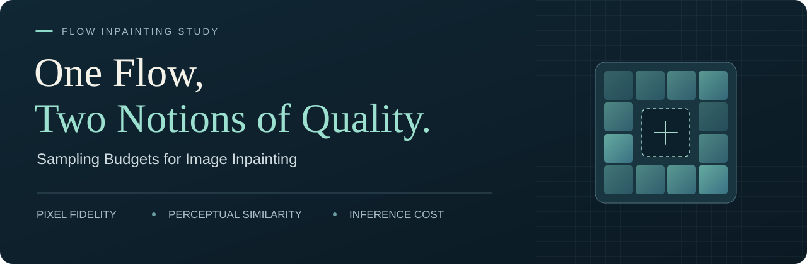
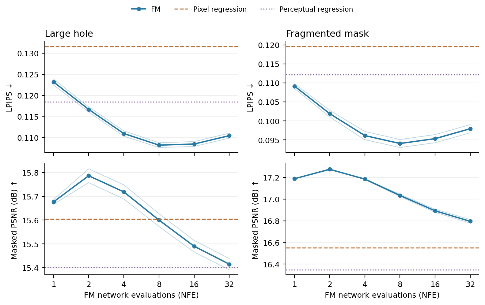
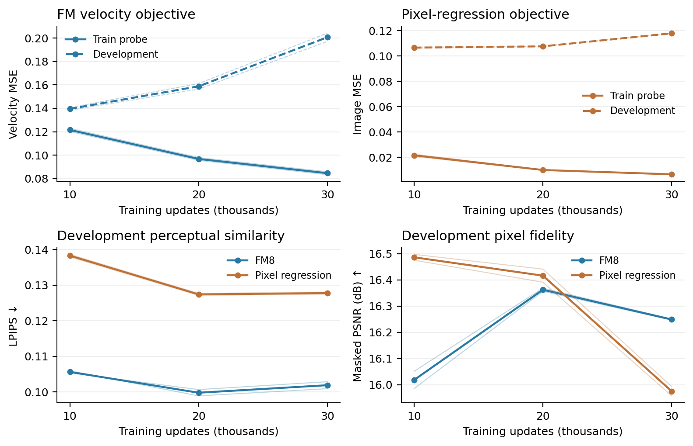

<p align="center">
  
</p>

<h1 align="center">One Flow, Two Notions of Quality</h1>
<p align="center"><strong>Sampling Budgets for Image Inpainting</strong></p>
<p align="center">Yongji Chen · Kaichun You · Linwei Zhang · Zijun Tang</p>

<p align="center">
  <a href="#key-findings">Findings</a> ·
  <a href="#archived-test-results">Results</a> ·
  <a href="#quick-start">Quick start</a> ·
  <a href="docs/PROTOCOL.md">Protocol</a> ·
  <a href="docs/REPRODUCE.md">Reproduction</a> ·
  <a href="CITATION.cff">Cite</a>
</p>

<p align="center">
  <strong>64 × 64</strong> Oxford-IIIT Pet &nbsp; / &nbsp;
  <strong>14.99M</strong> parameters &nbsp; / &nbsp;
  <strong>2</strong> seeds &nbsp; / &nbsp;
  <strong>2</strong> mask geometries
</p>

---

**Does more sampling computation always improve image inpainting?** We study this question within fixed conditional flow-matching models, and compare them with independently trained pixel and perceptual regressors using the same CNN architecture, training data, and update budget.

This repository contains the research code, archived results, and figure sources for the study.

## Key findings

<table>
  <tr>
    <td width="33%" valign="top"><strong>01 · Pixel fidelity</strong><br><br><strong>2 evaluations</strong><br>Highest masked PSNR in the tested development sweep.</td>
    <td width="33%" valign="top"><strong>02 · Perceptual similarity</strong><br><br><strong>8 evaluations</strong><br>Lowest LPIPS in the same development sweep.</td>
    <td width="33%" valign="top"><strong>03 · Inference cost</strong><br><br><strong>7.4× latency</strong><br>FM8 versus single-pass perceptual regression on the recorded RTX 4090 system.</td>
  </tr>
</table>

**The preferred budget depends on the quality criterion.** Beyond eight evaluations, both reference-based metrics worsen over the tested budgets. More computation does not guarantee a better reconstruction.



*Development set, NFE ∈ {1, 2, 4, 8, 16, 32}. Each curve uses frozen checkpoints and fixed image–mask–noise conditions. Thin lines show the two training seeds; thick lines show their mean. The two mask geometries are reported separately. This is not a test-set NFE sweep.*

[Figure data](results/development/figures_nfe_source.csv) · [Vector PDF](figures/nfe_quality.pdf) · [Experimental protocol](docs/PROTOCOL.md)

## Archived test results

The FM8 setting was selected on development LPIPS. Results below average two training seeds and weight the two geometries equally.

| Method | NFE | LPIPS ↓ | Masked PSNR ↑ | Batch-1 median latency |
|---|---:|---:|---:|---:|
| Pixel regression | 1 | 0.13119 | 15.906 dB | 3.77 ms |
| Perceptual regression | 1 | 0.12046 | 15.723 dB | 3.82 ms |
| Conditional FM | 8 | **0.10621** | **16.159 dB** | 28.41 ms |

FM8 reduces mean LPIPS by **19.0%** relative to pixel regression and **11.8%** relative to the tested perceptual regressor. The associated PSNR gains are **0.254 dB** and **0.437 dB**, respectively, calculated from unrounded results. Its single-image inference latency is approximately **7.4×** that of perceptual regression on the recorded RTX 4090 system.

<details>
<summary><strong>How to interpret these results</strong></summary>

These are overall averages. Against pixel regression, the PSNR gain is concentrated in fragmented masks. The perceptual-regression control was designed after the original FM/pixel-regression test results had been observed. Its coefficient was selected using development data before its own test evaluation. The results do not establish universal superiority, optimal budgets outside the tested settings, distributional realism, or semantic diversity. Image-bootstrap intervals condition on the two trained seeds.

</details>

Sources: [test summary](results/test_summary.json), [timing records](results/latency.json), and [perceptual-loss selection](results/perceptual_selection.json).

## Quick start

These commands inspect the released files and display archived results. They require only Python 3.10+ and do not train a model, run inference, or download weights.

```bash
git clone https://github.com/Yongji0427/flow-inpainting-study.git
cd flow-inpainting-study
python scripts/check_release.py
python scripts/show_results.py
```

To redraw the numerical figures from the included CSV tables:

```bash
python -m pip install -r requirements-figures.txt
python scripts/plot_results.py
```

> **Reproduction scope.** The original research scripts are preserved byte-for-byte. Training and test pipelines depend on historical initialization files, prepared data, mask banks, and frozen provenance records that are not all included here. A fresh clone supports code inspection, aggregate-result checks, and numerical figure regeneration. It does **not** support a one-command replay of the complete training history. See [Reproduction guide](docs/REPRODUCE.md) before running the historical entry points.

## Controlled comparison

| Model | Training objective | Inference |
|---|---|---|
| Pixel regression | Missing-region image MSE | One CNN evaluation |
| Perceptual regression | Image MSE + frozen VGG16 feature loss | One CNN evaluation; no VGG pass at inference |
| Conditional flow matching | Missing-region velocity MSE | Uniform forward Euler integration |

All three restoration CNNs have **14,986,435 trainable parameters** and use **30,000 updates**, with seeds 0 and 1. Initialization, image draws, mask-pair draws, and horizontal flips are matched within a seed. Matching update counts does not match training FLOPs: perceptual regression additionally evaluates a frozen feature network.

The paired masks each remove 1,638 of 4,096 pixels. They preserve missing area, quadrant counts, and the central mask pattern, with annotation-based matching tolerances. After matching, the protocol retains **2,812 training**, **124 development**, and **3,585 official-test** images. Full conditions and configuration selection are in [Experimental protocol](docs/PROTOCOL.md).

## Training diagnostics

<details>
<summary><strong>View training objectives and development quality</strong></summary>



*Training-probe objectives decrease while development-probe objectives rise. Task metrics follow a different trajectory. Task-quality curves use one fixed mask pair per image; the final development NFE sweep uses four. The final comparisons retain the predetermined 30k endpoint.*

[Vector PDF](figures/training_dynamics.pdf) · [Validation notes](docs/VALIDATION.md)

</details>

## Explore the repository

| If you want to… | Start here |
|---|---|
| Understand the comparison and selection protocol | [Experimental protocol](docs/PROTOCOL.md) |
| Inspect the archived measurements | [Test summary](results/test_summary.json) · [Timing](results/latency.json) · [Development tables](results/development) |
| Find a model, trainer, or evaluation script | [Code map](docs/CODE_MAP.md) |
| Rebuild figures or check prerequisites | [Reproduction guide](docs/REPRODUCE.md) |
| See what was checked for this release | [Validation](docs/VALIDATION.md) |

<details>
<summary><strong>Directory map and historical naming</strong></summary>

```text
GeoStep/             Original model, mask, training, evaluation, and analysis scripts
                     plus historical protocol files; see docs/CODE_MAP.md
results/             Archived test summaries, selection/timing records, and plot CSVs
data/                Frozen split manifest; no original photographs or annotations
figures/             Numerical figures rebuilt from the included tables
scripts/             Lightweight release checks, result display, and plotting
tests/               Synthetic CPU checks for masks, architecture, and sampling
provenance/          SHA-256 records for copied source and data files
docs/                Protocol, execution prerequisites, and code map
```

`GeoStep` is the internal experiment name. Early-stage helpers remain where required by the formal scripts' imports. Their presence does not make pilot settings part of the final paper comparison. Remote collection scripts, server launchers, unrelated follow-up experiments, checkpoints, and dataset images are excluded.

</details>

## Environment and validation

<details>
<summary><strong>Dependencies and synthetic CPU checks</strong></summary>

The recorded training environment used **PyTorch 2.7.1+cu128**, CUDA, BF16, and an RTX 4090. [requirements.txt](requirements.txt) lists direct dependencies rather than a complete environment lock. Install a compatible PyTorch/TorchVision CUDA build for the target machine.

For synthetic CPU checks after installing the model dependencies:

```bash
python -m unittest discover -s tests -v
```

These checks validate implementation properties; they do not reproduce model quality or validate the original CUDA/BF16 execution. Release checks and their limitations are documented in [Validation](docs/VALIDATION.md).

</details>

## Data and attribution

Obtain the dataset from the [Oxford-IIIT Pet dataset page](https://www.robots.ox.ac.uk/~vgg/data/pets/). The repository includes only the frozen image-ID split manifest, not the dataset itself. See [Data instructions](data/README.md).

The study builds on [Flow Matching](https://arxiv.org/abs/2210.02747), [U-Net](https://arxiv.org/abs/1505.04597), [perceptual feature losses](https://arxiv.org/abs/1603.08155), and [LPIPS](https://arxiv.org/abs/1801.03924). Dependency and dataset terms remain with their respective projects. A project-wide license has not yet been specified for this release.

Citation metadata for this code repository is provided in [CITATION.cff](CITATION.cff).
