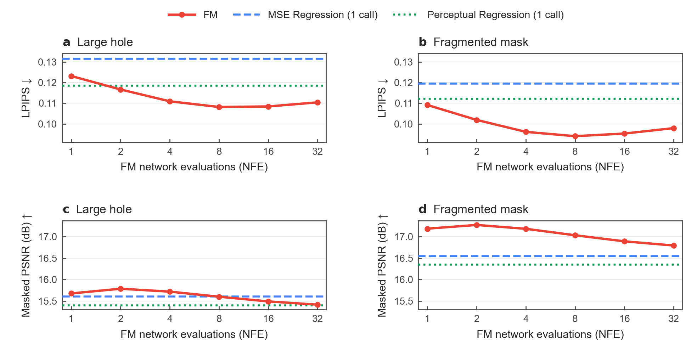

# Figure gallery and source data

The numbered files match the final [report](../paper/OneFlow_Report.pdf) and
[supplement](../paper/OneFlow_Supplementary.pdf). Curves show seed means only;
individual seed values remain in the source tables. No error band is implied.

Run all nine plots from the repository root:

```bash
python -m pip install -r requirements-figures.txt
python scripts/plot_results.py
```

PDF, editable SVG and PNG exports are written to `figures/main/` and
`figures/supplementary/`. Figure 1a and Figure 2 are supplied artwork and remain
unchanged. No training, model inference, pretrained-weight download or GPU is needed.

## Main figures

| Figure | PDF / image | Source | Script |
|---|---|---|---|
| 1a: model comparison schematic | [PDF](../figures/main/fig01a_model_overview.pdf) | Preserved supplied artwork | Not regenerated |
| 1b: sampling budget summary | [PDF](../figures/main/fig01b_sampling_budget.pdf) · [PNG](../figures/main/fig01b_sampling_budget.png) · [SVG](../figures/main/fig01b_sampling_budget.svg) | [Development NFE table](../results/development/figures_nfe_source.csv), [normalization](../results/figure_values/fig01b_provenance.json) | `scripts/plot_sampling_budget.py` |
| 2: framework | [PNG](../figures/main/fig02_framework.png) | Preserved supplied artwork | Not regenerated |
| 3: NFE and quality | [PDF](../figures/main/fig03_nfe_quality.pdf) · [PNG](../figures/main/fig03_nfe_quality.png) · [SVG](../figures/main/fig03_nfe_quality.svg) | [Development NFE table](../results/development/figures_nfe_source.csv) | `scripts/plot_quantitative_figures.py` |
| 4: training dynamics | [PDF](../figures/main/fig04_training_dynamics.pdf) · [PNG](../figures/main/fig04_training_dynamics.png) · [SVG](../figures/main/fig04_training_dynamics.svg) | [EMA objectives](../results/development/figures_training_objectives.csv), [task quality](../results/development/figures_task_learning.csv) | `scripts/plot_quantitative_figures.py` |
| 5: favorable and failed completions | [PDF](../figures/main/fig05_qualitative_results.pdf) · [PNG](../figures/main/fig05_qualitative_results.png) · [SVG](../figures/main/fig05_qualitative_results.svg) | [20 archived tiles](../results/qualitative/test_qualitative_tiles.npz), [selection provenance](../results/qualitative/test_qualitative_provenance.json) | `scripts/plot_qualitative_results.py` |



Figure 3 uses four mask pairs per development image and four fixed FM noise
samples per condition. Regression lines are one-call references. The sweep is
confined to development data.

## Supplementary figures

| Figure | PDF / image | Archived input |
|---|---|---|
| S1: learning curves | [PDF](../figures/supplementary/figS01_learning_curves.pdf) · [PNG](../figures/supplementary/figS01_learning_curves.png) | [Task quality by mask and step](../results/development/task_learning_pair0.csv) |
| S2: objective diagnostics | [PDF](../figures/supplementary/figS02_objective_diagnostics.pdf) · [PNG](../figures/supplementary/figS02_objective_diagnostics.png) | [Online and EMA objectives](../results/development/training_objectives.csv) |
| S3: FM time-bin diagnostics | [PDF](../figures/supplementary/figS03_time_bin_diagnostics.pdf) · [PNG](../figures/supplementary/figS03_time_bin_diagnostics.png) | [Time-bin objectives](../results/development/fm_time_bins_30k.csv) |
| S4: CNN capacity | [PDF](../figures/supplementary/figS04_model_capacity.pdf) · [PNG](../figures/supplementary/figS04_model_capacity.png) | [Seed-0 width comparison](../results/development/capacity_seed0.csv) |
| S5: NFE by mask geometry | [PDF](../figures/supplementary/figS05_nfe_quality.pdf) · [PNG](../figures/supplementary/figS05_nfe_quality.png) | [Development NFE sweep](../results/development/nfe_sweep_dev.csv) |

All five are generated by `scripts/plot_quantitative_figures.py`; each also has
an editable SVG with the same filename stem. S1 uses one fixed mask pair per
image; S4 and S5 use four. S4 has one training seed; the remaining numerical
curves summarize two seeds. These evaluation conditions are not interchangeable.

The plot coordinate audit is written to `figures/plotted_coordinates.json`.
Rendering can vary with installed fonts and library versions; the archived
measurements, averaging rules and plotted values are the reproducibility target.
